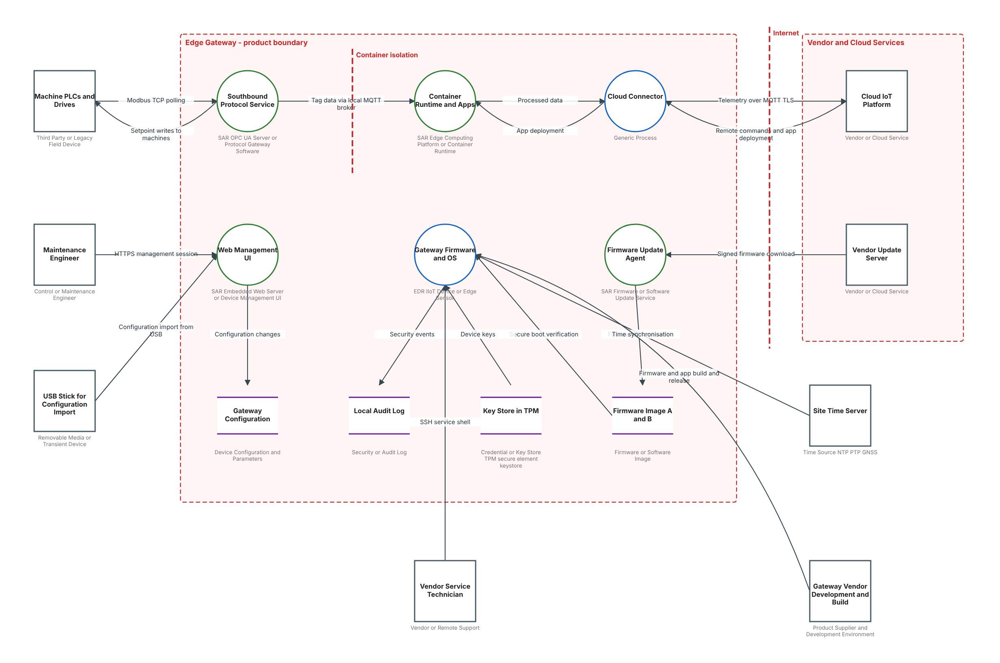

# OT Threat Model Templates for Microsoft TMT (IEC 62443)

Free templates for the [Microsoft Threat Modeling Tool](https://aka.ms/threatmodelingtool) (TMT) for **operational technology (OT) and industrial control systems**. You draw your PLCs, SCADA servers, gateways, protocols and security zones, and TMT generates OT-specific threats. Each threat is mapped to **IEC 62443** requirements and **MITRE ATT&CK for ICS** techniques, and has fields for risk scoring and treatment.

**Documentation:** [docs/index.html](docs/index.html) (also available in Korean). The website is in the `docs` folder and is published with GitHub Pages.

## Templates

| Template | For | Standards | Threats |
|---|---|---|---|
| **OT Product and System** | Product suppliers, system integrators | IEC 62443-4-2, 3-3, 4-1 | 110 |
| **OT Plant and Site Risk Assessment** | Asset owners, plant OT security teams | IEC 62443-3-2, 2-1, 2-4, IEC 61511 | 43 |

Both templates share the same 82 OT stencils, alongside Microsoft's 52 built-in stencils, so a diagram drawn with one template opens with the other.

## Quick start

1. Install the [Microsoft Threat Modeling Tool](https://aka.ms/threatmodelingtool).
2. In TMT, under **Template For New Models**, click **Browse** and choose one of the `.tb7` files.
3. Click **Create A Model**, draw the system, and answer the properties of each element and flow.
4. Open **View > Analysis View** to see the generated threats.

To see it working first, open one of the models in [`examples/`](examples). The edge gateway generates 138 threats and the gas pipeline 114.

## What's new in 2.0

- Each threat appears once, where it belongs: there are 8 threat families, and each is generated on one kind of flow.
- Fewer properties: 16 on a component (was 25), 7 on a flow (was 21), 3 on a data store (was 12).
- Software stencils no longer ask hardware questions such as debug ports or USB.
- Hard-wired signals and local operator input are recognised as non-network media.
- New threats cover isolation bypass, wiring tampering and data at rest in read-only stores.
- New tool `check_model.py` finds threats that would be repeated or missing.

Threat IDs are unchanged from 1.x.

## Licence

MIT, see [LICENSE](LICENSE). Stencil icons: [Tabler Icons](https://tabler.io/icons) (MIT). MITRE ATT&CK® is a registered trademark of The MITRE Corporation. IEC 62443 and IEC 61511 are standards of the International Electrotechnical Commission. Not affiliated with Microsoft, MITRE or the IEC.
